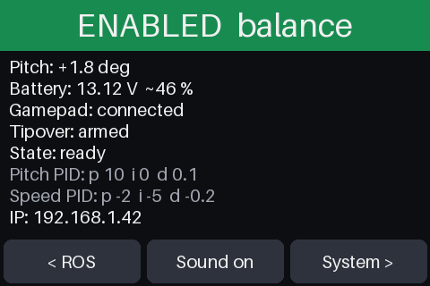
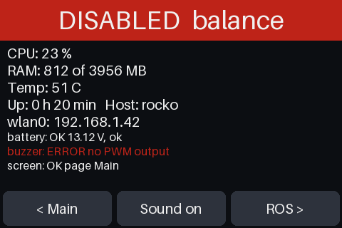

# The robot extras: status screen, buzzer and battery monitor

Three add-ons that tell a person what the robot is doing without a laptop: a 3.5" touch screen on the robot, a
buzzer that sounds on boot, enable, disable and warnings, and a battery voltage monitor. Wiring and Pi setup are in
[Fit the screen, buzzer and battery monitor](../guides/fit-the-extras.md); this page explains how they work and why.

**What has been checked (2026-11-27):** the logic and the drawing on a laptop and in the dev container, and the
"optional" rule below against the mock (`verify_supervisor.sh` section 12; the
[verification ladder](verification-ladder.md) has the details). **None of it has run on the Pi or with the real
parts**: the panel driver on a Pi 5, the PWM and I²C setup lines, the touch axes and the INA226 are all untested. The
guide has the procedure.

## The rule: every extra is optional

The robot must drive and balance exactly as before whether an extra works, is broken, is missing or was never fitted.
So:

- **Each extra is its own process** (`BatteryMonitor.py`, `Buzzer.py`, `StatusScreen.py`), started by the boot launch
  `rocko_robot.launch.py` beside the supervisor. A crash ends only that process: a launch only stops when a node marked
  to stop it ends, and these are not. `battery:=false`, `buzzer:=false` or `screen:=false` leaves one out.
- **A missing part is not a crash.** The node keeps running, logs the error once, reports it (below) and tries its
  hardware again every 30 s (`health.RETRY_PERIOD_S`), so a sensor plugged in later is found without a restart.
- **Nothing the robot needs waits on an extra.** The only service an extra offers, `/rocko/set_buzzer_muted`, is
  called by the dashboard's and the screen's mute buttons. The supervisor *reads* the battery voltage when it has one
  (see [the battery rule](#battery)), and an unknown voltage never refuses anything.
- **None of them is on the 100 Hz path.** They are separate Python processes; the screen also lowers its own
  priority. The battery sensor has its own I²C bus, so it cannot delay the IMU's read on bus 1.

A crashed extra stays down until the robot launch restarts; it is not restarted automatically. Automatic restart was
tried and removed on 2026-11-27: on Ctrl-C or a service stop, the extras exited a moment before the launch began its
own shutdown, the launch restarted them, and it never ended.

## How a person sees what works

Each extra publishes one status every second on `/diagnostics` (`diagnostic_msgs/DiagnosticArray`, the standard ROS
topic for "is this part healthy"), named `rocko/battery`, `rocko/buzzer` or `rocko/screen`, with a level (OK, WARN,
ERROR), a message and a few values. The dashboard's three extras cards and the screen's System page show them. An
extra that has not reported for 5 s (`health.STALE_AFTER_S`) shows as **NOT RUNNING** (never started, or crashed), never as its last level:
an old "OK" could be wrong. The code is `rocko_env/extras/health.py`; its errors also reach the dashboard's warnings
list through `/rosout` like any other log line.

```
BatteryMonitor.py ──/rocko/battery (BatteryState)──> Supervisor.py (refuses enable when flat)
        │
        └──────────┐
Buzzer.py ─────────┼──/diagnostics──> Dashboard.py ──> the extras cards in the browser
StatusScreen.py ───┘         └──────> StatusScreen.py (System page), Buzzer.py (battery level)
Dashboard.py, StatusScreen.py ──/rocko/set_buzzer_muted (std_srvs/SetBool)──> Buzzer.py
```

## Battery

The battery is a 12 V (four-cell, 12.8 V nominal) 10 Ah LiFePO4. A TI INA226 measures its voltage on its **own** I²C
bus (`/dev/i2c-3`, made by a line in the Pi's config.txt). `BatteryMonitor.py` reads it once a second and publishes
`/rocko/battery` (`sensor_msgs/BatteryState`).

- **The voltage is smoothed** (a first-order low-pass filter with a 10 s time constant, `battery.SMOOTHING_S`), so one
  hard acceleration's sag does not set off a warning.
- **The percentage is rough.** A LiFePO4 cell's voltage is nearly flat between about 90 % and 20 %, so the voltage is
  the number to trust. `battery.CHARGE_TABLE` is a typical published chart, not measured on this battery, and it is
  only right for a resting battery: while driving the estimate reads low.
- **Levels:** at `WARN_V` the screen and dashboard turn amber and the buzzer beeps once; at `CRITICAL_V` they turn red,
  the buzzer plays its critical tune, and **the supervisor refuses to enable** (rule 2 of
  [the supervisor](robot-supervisor.md)), as long as a reading is fresh: one older than the supervisor's
  `BATTERY_MAX_AGE_S` (5 s, a separate constant from `health.STALE_AFTER_S`) counts as unknown. The numbers live in `rocko_env/extras/battery.py` and are proposed, not
  tested on this battery. To leave a level the voltage must climb `HYSTERESIS_V` above it, so a voltage sitting on a
  threshold does not beep every second. The supervisor's check uses `CRITICAL_V` alone, so a battery recovering
  between `CRITICAL_V` and `CRITICAL_V + HYSTERESIS_V` can still show red while enabling is allowed.
- **Nothing disables a robot that is already enabled**, however flat the battery: cutting the motors while balancing
  drops the robot. The check is at enable, when the motors are idle and the voltage is a resting voltage.
- **Current is off by default.** The usual INA226 breakout's own 0.1 Ω shunt saturates at 0.8 A, far below what the
  motors draw, so the guide wires it for voltage only. `shunt_ohms` in `extras.yaml` turns current on if all the motor
  current goes through a shunt of that value.
- A reading outside 5 to 16 V is a wiring fault and is not published: a 0 V "battery" would block enabling for a loose
  wire.

## Buzzer

A **passive** buzzer is a small speaker: it sounds only while driven with a square wave, at the wave's frequency, so
it can play notes. The Pi's hardware PWM makes the wave (GPIO 12, through Linux's `/sys/class/pwm` files), which keeps
the pitch steady however busy the CPU is. `Buzzer.py` watches `/rocko/state`, `/joy`, the tipover cutoff's log lines on
`/rosout` and the battery level on `/diagnostics`. Each event plays once, when it happens, never repeatedly:

| Event | When |
| --- | --- |
| boot | the supervisor's first stack is `ready` (once per start of `Buzzer.py`) |
| enabled, disabled | `enabled` changes, from any source |
| fault | `phase` becomes `fault` (an IMU failure shows up here, as the stack's fault) |
| tipover | the tipover cutoff logs that it tripped |
| gamepad lost | enabled, and no `/joy` for 1 s |
| battery low, battery critical | the battery level gets worse |

The tunes are a table in `rocko_env/extras/sounds.py` (`TUNES`): notes of (frequency in Hz, duration in s). Edit a
tune there; add an event in `SoundEvents.update()`. **Mute** is on the dashboard's buzzer card and the screen's middle
button; both call `/rocko/set_buzzer_muted`. The setting is saved to `~/.rocko/buzzer_muted` (on the Pi, root's home),
so a muted robot stays quiet after a reboot. Unmuting plays one short chirp.

## Status screen



The panel is 480 x 320 pixels, driven over SPI by the Linux `fbtft` driver, which makes it a *framebuffer*: a file,
`/dev/fbN`, whose bytes are the pixels. `StatusScreen.py` draws a picture twice a second with Pillow, converts it to the
panel's 16-bit pixel format (5 bits red, 6 green, 5 blue) and writes it there; it skips the write when nothing changed,
because the SPI link is slow. The touch chip (ADS7846) is read from `/dev/input/eventN`. The bottom bar is three large
buttons: left and right change page, the middle one mutes or unmutes. They are large because an uncalibrated resistive
panel can be off by tens of pixels.

| Page | Shows |
| --- | --- |
| Main | ENABLED (green) / DISABLED (red) / NO SUPERVISOR (grey) and the mode across the top; pitch; battery; gamepad connected; tipover cutoff; the supervisor's phase and fault message; the pitch and speed loops' `p`, `i`, `d`; the IP address |
| System | CPU, memory, temperature, uptime, hostname, every IP address, and each extra's health |
| ROS | every expected controller with its state and expected state, and every expected node, from `/rocko/state` (a wrong one in red) |



The gains come from the installed `rocko_controllers.yaml` (what balance mode loads), so a value changed while running
with `ros2 param set` is not shown. **To change the screen, edit `rocko_env/extras/screen_layout.py` only:** a line on
the main page is one entry in `MAIN_FIELDS` (a label and a function that returns the text and its colour); a page is
one entry in `PAGES`. `screen_draw.py` paints whatever it returns. `preview_png:=/tmp/screen.png` makes the node draw
into a picture instead of the panel, which is how the pictures on this page were made (with made-up values, by
`tools/screen_render_check.py`).

## Dashboard changes

The state card fills **green while enabled, red while disabled, grey when unknown**, with Enable in green and Disable
in red, so it reads at a glance; the same colours as the screen. Three cards below it show the extras' reports, and
the buzzer card has the Mute button. [Use the dashboard](../guides/use-the-dashboard.md) has the details.

## Settings a person may change

`rocko_env/extras/extras.yaml` holds the settings you may need on the robot: device paths, the INA226 address, the PWM
chip, the screen's rotation and the touch axes. Every setting is commented out: each node's code has the default, and
an uncommented line overrides it. One bad line there stops all three extras from starting (they share the file), and
nothing else. Not a gain or limit file: nothing in it can move the wheels.

## What is not true yet

- Nothing here has run on the Pi or with the real panel, buzzer or INA226.
- Whether this panel's driver (`piscreen` overlay, ILI9486) works on a Raspberry Pi 5 under Ubuntu 24.04 is not known.
  The guide says what to try.
- The screen's CPU cost on the Pi beside the 100 Hz balance loop is not measured. The dashboard's was, without a
  browser connected ([loop timing](../journal/2026-11-24-loop-timing-on-the-pi.md)); measure the screen the same way
  before a balance test.
- The battery thresholds and charge table are from a typical chart, not this battery.
- **The screen cannot be fitted with today's motor wiring**: the panel uses the same header pins as all four motor
  driver lines. The guide has the conflict and the pin moves; the code still has the old pins until the owner rewires.
